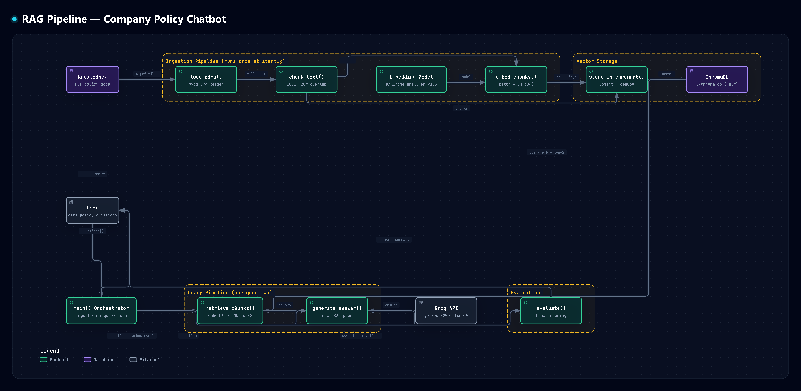

# RAG Policy Assistant




---

## What This Project Does

A **Retrieval-Augmented Generation (RAG)** chatbot that answers employee questions from company policy PDFs. It ingests documents, embeds them into a vector database, retrieves relevant context for each query, and generates grounded answers using an LLM — preventing hallucination by constraining the model to only use retrieved context.

---

## Pipeline Explanation

| Step | Function | What It Does | Key Decision |
|------|----------|--------------|--------------|
| 1 | `load_pdfs()` | Extracts text from all PDFs in `knowledge/` using `pypdf` | `pypdf` for zero-dependency PDF parsing; fails fast on scanned docs |
| 2 | `chunk_text()` | Sliding window: 100 words, 20-word overlap (stride=80) | Word-based chunking avoids tokenizer dependency; overlap preserves context at boundaries |
| 3 | `embed_chunks()` | Batch encodes chunks via `BAAI/bge-small-en-v1.5` (384-dim) | BGE-small: strong retrieval benchmarks, fast CPU inference, open weights |
| 4 | `store_in_chromadb()` | Upserts chunks + embeddings to persistent ChromaDB (HNSW index) | `PersistentClient` survives restarts; `delete(where)` prevents duplicates on re-run |
| 5 | `retrieve_chunks()` | Embeds query → ANN search (top-2) → returns chunk texts | `TOP_K=2` balances context precision vs. token budget |
| 6 | `generate_answer()` | Strict RAG prompt + `gpt-oss-20b` via Groq, `temperature=0.0` | Temp 0 = deterministic, factual answers; prompt enforces "ONLY context" |
| 7 | `evaluate()` | Human-in-the-loop scoring: good / bad / hallucinated | Minimal viable eval for iteration; CI-ready with `EOFError` handling |

---

## Tech Stack

| Component | Tool | Why |
|-----------|------|-----|
| PDF Parsing | `pypdf` | Pure Python, no system deps, handles text-based PDFs |
| Chunking | Stdlib `str.split()` | Zero dependencies; word-count proxy for tokens |
| Embeddings | `sentence-transformers` + `BAAI/bge-small-en-v1.5` | 384-dim, SOTA on BEIR, runs locally on CPU |
| Vector DB | `chromadb` (PersistentClient) | Embedded SQLite + HNSW, no server needed, metadata filtering |
| LLM | Groq API (`openai/gpt-oss-20b`) | Free tier, OpenAI-compatible, fast inference |
| Config | `python-dotenv` | Keeps `GROQ_API_KEY` out of source |

---

## Project Structure

```
rag_project/
    ├── knowledge/                 # Company policy PDFs (5 files)
    │   ├── 01_leave_and_attendance_policy.pdf
    │   ├── 02_remote_work_policy.pdf
    │   ├── 03_data_security_and_privacy_policy.pdf
    │   ├── 04_expense_and_reimbursement_policy.pdf
    │   └── 05_code_of_conduct_policy.pdf
    ├── chroma_db/                 # Persistent ChromaDB (SQLite + HNSW)
    ├── main.py                    # Complete pipeline (200 lines)
    ├── .env                       # GROQ_API_KEY=your_key_here
    ├── .gitignore
    └── requirements.txt
```

---

## Setup Instructions

```bash
# 1. Clone repo
git clone <your-repo-url>
cd rag_project

# 2. Create venv
python -m venv .venv
source .venv/bin/activate  # Windows: .venv\Scripts\activate

# 3. Install dependencies
pip install -r requirements.txt

# 4. Add API key
echo "GROQ_API_KEY=your_groq_key" > .env

# 5. Add PDFs to knowledge/ (already included)

# 6. Run
python main.py
```

**requirements.txt:**
```txt
pypdf
sentence-transformers
chromadb
groq
python-dotenv
```

---

## Example Output

```
Q: How many sick leave days do employees get?
A: Employees receive 10 sick leave days per calendar year.

Q: What is the remote work policy?
A: Employees may work remotely up to 2 days per week with manager approval.

Q: What happens if company equipment is lost or stolen?
A: Report immediately to IT and file a police report if stolen. Employee may be liable for replacement cost.

Q: What is the capital of France?
A: I don't have that information.
```

---

## Key Technical Decisions

| Decision | Rationale |
|----------|-----------|
| **Chunk: 100 words / 20 overlap** | ~130 tokens/chunk fits BGE's 512-token limit; 20% overlap prevents boundary loss without excessive duplication |
| **Temperature = 0.0** | Greedy decoding = deterministic, repeatable answers; essential for eval consistency and user trust |
| **bge-small-en-v1.5 (384-dim)** | Best retrieval quality/speed tradeoff for CPU; outperforms `all-MiniLM-L6-v2` on BEIR |
| **ChromaDB over Pinecone** | Zero infra, embedded persistence, no API keys, sufficient for <100K vectors |
| **TOP_K = 2** | Minimal context window (≈260 tokens) reduces noise and cost; forces high retrieval precision |

---

## What I Would Improve In Production

1. **Hybrid Search** — Combine vector + BM25 (keyword) for exact ID/acronym matches
2. **Cross-Encoder Reranking** — `bge-reranker-base` on top-20 → top-2 for precision
3. **Automated Evaluation** — RAGAS / DeepEval for faithfulness, context precision, answer relevancy
4. **FastAPI Endpoint** — `/query` with streaming, auth, rate limiting, request logging
5. **Incremental Ingestion** — Hash-based change detection to avoid re-embedding unchanged PDFs

---

## Author

**Atharv** — BSc IT 2025 — Building AI engineering skills through hands-on RAG systems.